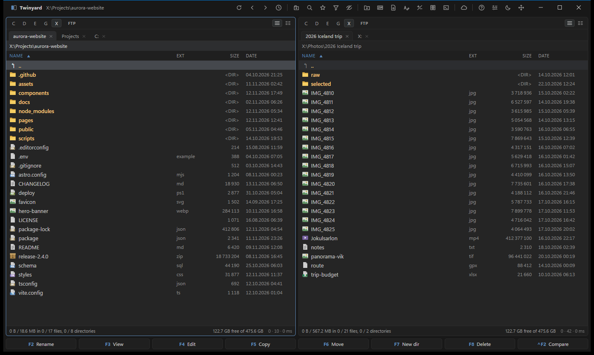

# Twinyard

A fast, keyboard-driven, two-panel file manager for Windows, in the spirit of Total Commander.
Built with Rust, Tauri 2 and Svelte 5. Its focus is **FTP/FTPS that doesn't hang**, and file
operations that never leave a file half-written.



> **Status: 0.9, beta.** The author uses it every day, but expect rough edges.
> Windows 10/11 only (it uses Win32 APIs directly).

## Features

- **Two panels with tabs**, Total Commander key bindings (F3–F8, Tab, Ins, Ctrl+…), a brief
  (multi-column) view, quick search by typing, a quick filter, directory history and favourites.
- **Copy / move / delete** with progress, pause-free cancel, conflict and error dialogs, and long
  paths (>260 chars). Overwrites go to a temporary file first, so the old file stays intact until the
  new one is complete. Copy and move jobs run one after another in a queue.
- **FTP and FTPS** (explicit and implicit): one connection per job, timeouts everywhere, automatic
  reconnect and resume (REST/APPE), size check after every file, certificate pinning, CP1250
  file names on old servers, a fallback to Windows SChannel for servers rustls can't talk to, and a
  session log. **Imports connections from Total Commander** (`wcx_ftp.ini`).
- **Edit remote files (F4)**: Twinyard downloads the file, watches the copy, and offers to upload
  it when you save.
- **Archives**: ZIP (read and write), 7z, RAR, tar, tar.gz/tgz and gz (read only). Password-protected
  archives can be read. You browse an archive like a folder.
- **Compare and sync folders** (Shift+F2), also local ↔ FTP, optionally by content.
- **Built-in viewer** (text, hex, images) and **file diff**. You can use your own editor, viewer and
  diff tool instead.
- Multi-rename (Ctrl+M), file search by name or content (Alt+F7, also on FTP), the Explorer
  context menu, drag and drop to and from Explorer, and a file clipboard shared with Explorer.
- Dark, light or system theme. English or Polish interface.
- **Portable**: everything lives in a `data\` folder next to `twinyard.exe`. Nothing goes to the
  registry or `%APPDATA%`. FTP passwords are encrypted with Windows DPAPI.

Press **F1** in the app for the full list of keyboard shortcuts.

## Download

Get `twinyard-0.9.0-portable.zip` from [Releases](../../releases), unpack it anywhere and run
`twinyard.exe`. You need the WebView2 runtime, which is built into Windows 11 and present on
most Windows 10 installations.

The exe is not code-signed, so Windows SmartScreen may warn you on first start
(*More info → Run anyway*).

## Configuration

Open the gear icon in the title bar for the settings, or edit `data\config.toml` directly. It is
created on first start and re-read on every use, so changes apply at once. Example:

```toml
[tools]
editor = '"C:\Program Files\Notepad++\notepad++.exe" "%f"'
viewer = "builtin"
diff   = '"C:\Program Files\WinMerge\WinMergeU.exe" /e /u "%l" "%r"'
```

## Building from source

Requirements: Rust (stable, MSVC toolchain), Node.js 20+, and the
[Tauri prerequisites](https://tauri.app/start/prerequisites/) for Windows.

```powershell
cd app
npm install
npx tauri dev                      # development build with hot reload
cd ..
scripts\build-portable.ps1         # release build → dist-portable\twinyard\twinyard.exe
```

Tests:

```powershell
cargo test --workspace             # Rust (core, FTP engine, app)
node scripts/check-i18n.mjs        # every UI string has an English translation
node scripts/test-queue.mjs        # job queue logic
```

Live FTP tests need a local server and are skipped by default; see `crates/remote/tests/live.rs`.

### Project layout

| Path | What's there |
|---|---|
| `crates/core` | File system, operations, archives, search, config, no UI |
| `crates/remote` | FTP/FTPS engine, connections, Total Commander import, passwords |
| `app/src-tauri` | Tauri commands, job runner, Windows integrations |
| `app/src` | Svelte UI |
| `docs/` | Design notes and code reviews (in Polish) |

## License

MIT, see [LICENSE](LICENSE). RAR support uses the UnRAR library, which comes with its own license
terms; see [THIRD-PARTY-NOTICES.md](THIRD-PARTY-NOTICES.md).
